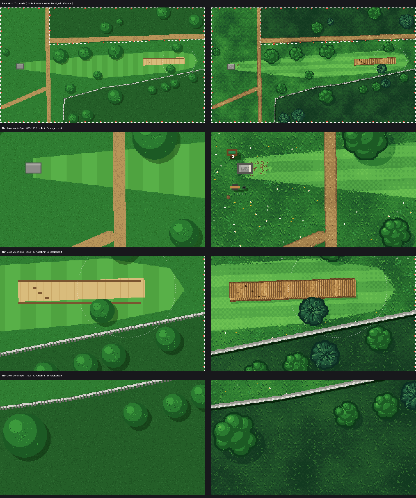
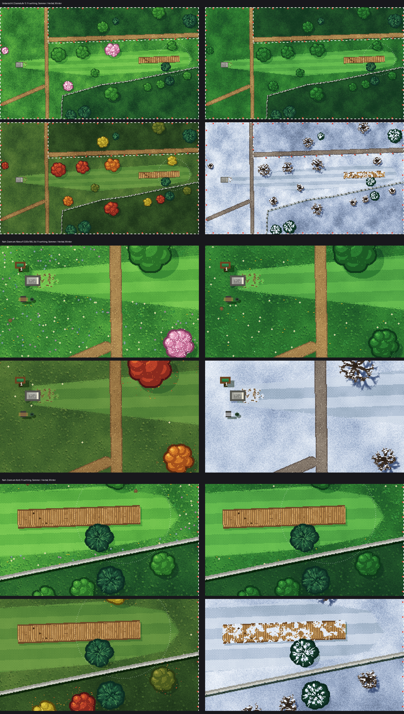

# Grafik-Update: Detailgrafik mit Jahreszeiten (Webversion)

Code: `grafik.js`, im Spiel eingebunden auf dem Branch `dev-graphic`
(Vorschau: www.discgolf-game.de/dev-graphic/). Gilt für alle Bahnen und das freie Feld.
Vorschau-Bilder neu erzeugen: `node werkzeuge/grafik_vorschau.mjs 1 docs/bilder`
(Spiellogik, Physik und Bahndaten bleiben unverändert, nur das Bild ändert sich).

**Einstellungen → Grafik und Jahreszeit:** „Nach Datum“ (Standard; Dez–Feb Winter, März–Mai Frühling,
Juni–Aug Sommer, Sep–Nov Herbst), eine feste Jahreszeit oder „Klassische Grafik“.

## Umgesetzt im Prototyp

| # | Vorschlag | Was sich ändert |
|---|---|---|
| 1 | **Größere Paletten** | 5–6 Stufen pro Fläche statt 2–3; Schatten kühler, Lichter wärmer |
| 2 | **Gras mit Struktur** | großflächiges Rauschen + Bayer-Dithering statt Pixelrauschen; Grasbüschel, Gänseblümchen, Löwenzahn, Klee, Maulwurfshügel |
| 3 | **Fairway** | Mähstreifen in Wurfrichtung, ausgefranste Kante zum Rough, abgelaufene Stelle vor dem Abwurf |
| 4 | **Wege** | dunkler Rand, hellere Mitte, einzelne Kiesel |
| 5 | **Bäume** | Krone aus mehreren Blättergruppen mit Kontur und Licht von links oben; ~30 % Kiefern (bläulich, Nadelbüschel); Schatten als dunklere Palettenstufe nach rechts unten |
| 6 | **Bowling-Deck** | Querdielen mit Fugen, Maserung, Nägeln, Schatten; Bowling-Pfeile als Dreiecke |
| 7 | **Abwurf** | Betonplatte mit Kante, Sprenkeln, Abwurflinie und Schatten |
| 8 | **Deko** | Bahnschild mit Bahnnummer, Bank und Mülleimer am Abwurf – sie suchen sich einen freien Platz neben dem Abwurf (nicht auf Weg, Fairway, OB oder unter Bäumen) |

## Vier Jahreszeiten

`zeichneHintergrundDetail(z, { jahreszeit })` mit `fruehling`, `sommer`, `herbst` oder `winter`.
Paletten und Deko stehen in `JAHRESZEITEN` am Ende von `werkzeuge/grafik_vorschau.js`.

| Jahreszeit | Boden | Bäume | Deko |
|---|---|---|---|
| Frühling | frisches Gelbgrün | hellgrün, ~30 % blühen rosa | viele Blumen (weiß, gelb, lila, blau), Blütenblätter unter Blütenbäumen |
| Sommer | sattes Grün (Standard) | dunkelgrün | Gänseblümchen, Löwenzahn, Klee |
| Herbst | olivgrün | orange, rot, gelb, braun gemischt | viel Laub am Boden, kaum Blumen; im Spiel fallen bunte Blätter aus den Kronen und treiben mit dem Wind |
| Winter | Schnee mit bläulichen Schatten, Wege matschig | Laubbäume kahl mit Ästen und Astschatten, Kiefern verschneit | Schnee auf dem Deck und der Bank, keine Blätter |

Auch die Putt-Ansicht (Seitenansicht am Korb) folgt der Jahreszeit: Himmel mit Sonne und Wolken,
Baumreihe in den Farben der Jahreszeit (im Winter kahl und verschneit), Wiese mit Mähstreifen,
Blumen, Laub oder Schnee; im Herbst fallen auch hier Blätter. Ohne Jahreszeit (klassisch, GBA) bleibt sie wie bisher.

Die Physik ändert sich nicht (Schnee bremst die Scheibe z. B. nicht stärker) – das wäre ein eigener Schritt.

## Weitere Ideen (noch nicht gebaut)

- **Tageszeit**: abendliches Licht als Paletten-Tausch
- **Animation**: Wind bewegt Baumkronen und Gras leicht (2–3 Frames), Blätter fallen
- **Zaun**: höher wirkender Maschendraht mit deutlicheren Pfosten (im Prototyp noch zu dezent)
- **Detailstufen**: Deko erst ab Zoomstufe „mittel“ zeigen (Übersicht bleibt ruhig – schon so umgesetzt ab 5 px/m)
- **Handgezeichnete Sprites** für Schild, Bank, Korb statt Code-Grafik, als kleine PNG-Atlas-Datei
- **Fotos als Vorlage**: Deko-Positionen (Bank, Schild, Mülleimer) als optionale Felder in `bahnen.js`
  (z. B. `deko: [{ art: "bank", x, y }]`), damit jede Bahn eigene Details bekommt

## Offene Punkte

- Laufzeit: das Bahnbild wird pro Zoomstufe einmal vorgerendert. Am Rechner 12–65 ms (Übersicht)
  bzw. 100–310 ms (nah, im Leerlauf vorbereitet) je Bahn – auf dem Handy noch messen.
- GBA-Version ist davon nicht betroffen.
