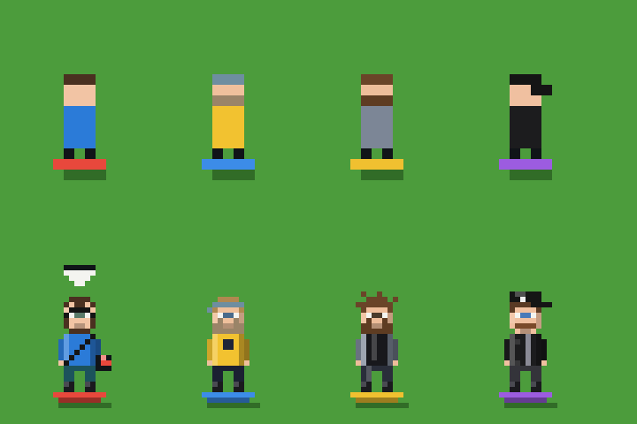
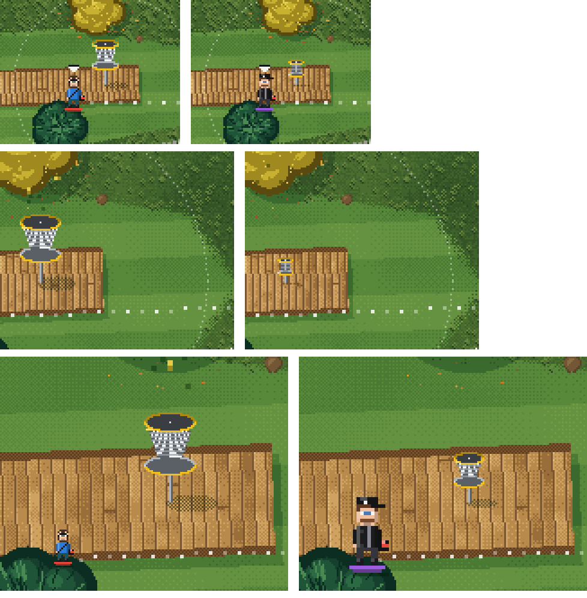
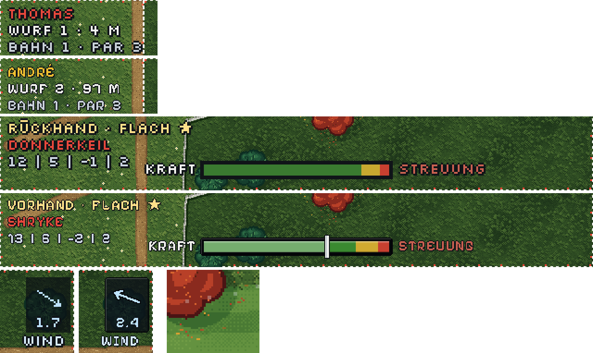
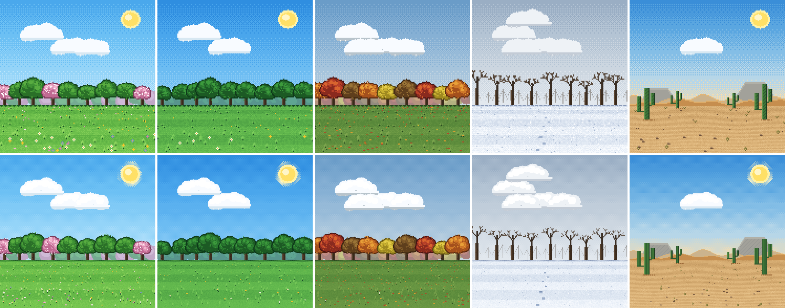
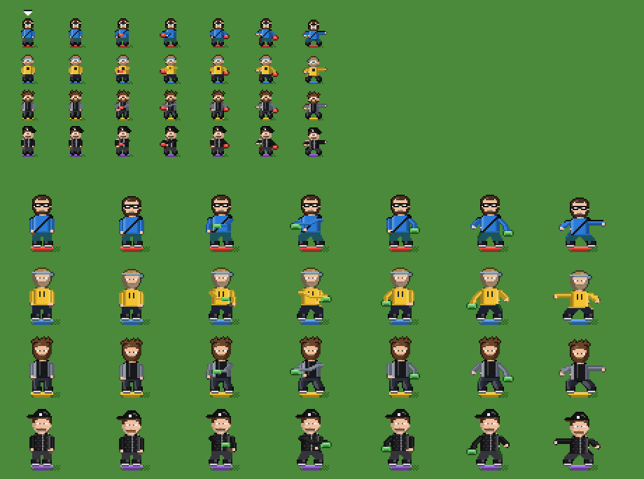
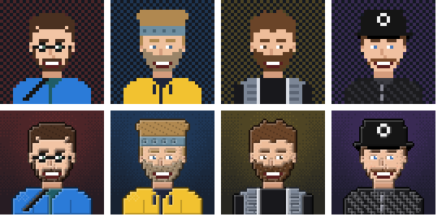
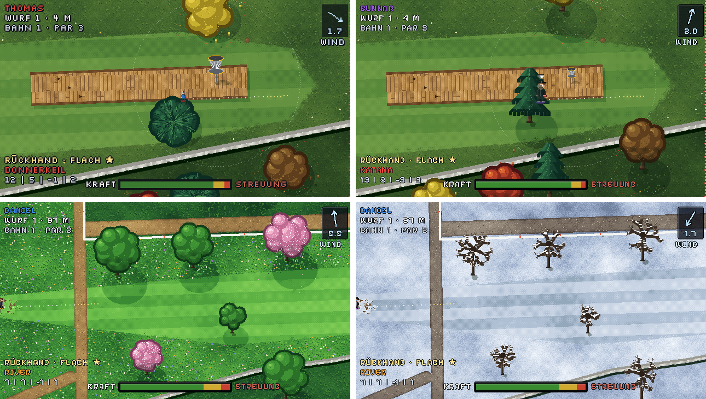

# Grafik-Update: Detailgrafik mit Jahreszeiten (Webversion)

Code: `grafik.js`, im Spiel eingebunden auf dem Branch `dev-graphic`
(Vorschau: www.discgolf-game.de/dev-graphic/). Gilt für alle Bahnen und das freie Feld.
Vorschau-Bilder neu erzeugen: `node werkzeuge/grafik_vorschau.mjs 1 docs/bilder`
(Spiellogik, Physik und Bahndaten bleiben unverändert, nur das Bild ändert sich).

**Einstellungen → Grafik und Jahreszeit:** „Nach Datum“ (Standard; Dez–Feb Winter, März–Mai Frühling,
Juni–Aug Sommer, Sep–Nov Herbst), eine feste Jahreszeit oder „Klassische Grafik“.

## Umgesetzt im Prototyp

| # | Vorschlag | Was sich ändert |
|---|---|---|
| 1 | **Größere Paletten** | 5–6 Stufen pro Fläche statt 2–3; Schatten kühler, Lichter wärmer |
| 2 | **Gras mit Struktur** | großflächiges Rauschen + Bayer-Dithering statt Pixelrauschen; Grasbüschel, Gänseblümchen, Löwenzahn, Klee, Maulwurfshügel |
| 3 | **Fairway** | Mähstreifen in Wurfrichtung, ausgefranste Kante zum Rough, abgelaufene Stelle vor dem Abwurf |
| 4 | **Wege** | dunkler Rand, hellere Mitte, einzelne Kiesel |
| 5 | **Bäume** | Krone aus mehreren Blättergruppen mit Kontur und Licht von links oben; ~30 % Kiefern (bläulich, Nadelbüschel); Schatten als dunklere Palettenstufe nach rechts unten |
| 6 | **Bowling-Deck** | Querdielen mit Fugen, Maserung, Nägeln, Schatten; Bowling-Pfeile als Dreiecke |
| 7 | **Abwurf** | Betonplatte mit Kante, Sprenkeln, Abwurflinie und Schatten |
| 9 | **Korb** | Putt-Ansicht: runder Ring mit Licht und Schatten, Ketten in zwei Lagen mit einzelnen Gliedern bis zum Kragen, Korb mit Gitter und gelbem Band, glänzende Stange mit Fuß, Schatten; auf der Bahn schräg von oben mit Ring, Ketten und Korb, wird beim Reinzoomen größer und feiner; im Winter Schnee auf dem Ring |
| 8 | **Deko** | Bahnschild mit Bahnnummer, Bank und Mülleimer am Abwurf – sie suchen sich einen freien Platz neben dem Abwurf (nicht auf Weg, Fairway, OB oder unter Bäumen) |

## Vier Jahreszeiten

`zeichneHintergrundDetail(z, { jahreszeit })` mit `fruehling`, `sommer`, `herbst` oder `winter`.
Paletten und Deko stehen in `JAHRESZEITEN` am Ende von `werkzeuge/grafik_vorschau.js`.

| Jahreszeit | Boden | Bäume | Deko |
|---|---|---|---|
| Frühling | frisches Gelbgrün | hellgrün, ~30 % blühen rosa | viele Blumen (weiß, gelb, lila, blau), Blütenblätter unter Blütenbäumen |
| Sommer | sattes Grün (Standard) | dunkelgrün | Gänseblümchen, Löwenzahn, Klee |
| Herbst | olivgrün | orange, rot, gelb, braun gemischt | viel Laub am Boden, kaum Blumen; im Spiel fallen bunte Blätter aus den Kronen und treiben mit dem Wind |
| Winter | Schnee mit bläulichen Schatten, Wege matschig | Laubbäume kahl mit Ästen und Astschatten, Kiefern verschneit | Schnee auf dem Deck und der Bank, keine Blätter |

Auch die Putt-Ansicht (Seitenansicht am Korb) folgt der Jahreszeit: Himmel mit Sonne und Wolken,
Baumreihe in den Farben der Jahreszeit (im Winter kahl und verschneit), Wiese mit Mähstreifen,
Blumen, Laub oder Schnee; im Herbst fallen auch hier Blätter.

Themen-Optiken der Wochenbahnen stehen mit in `JAHRESZEITEN` (bisher `wueste`: Sand mit Windrippeln,
Kakteen und Felsen statt Bäumen, rissige Flussbetten als OB, in der Putt-Ansicht Dünen, Tafelberge und Saguaros).
Die klassische Grafik wurde mit dem Abschied von der GBA-Version entfernt (Stand: Branch `V1.0_GBA`).

## Hohe Auflösung (quer und hochkant)

Mit Detailgrafik ist das Canvas 640 × 360 statt 320 × 180 echte Pixel (hochkant 360 × 640 statt 180 × 320) (`AUF = 2` in index.html).
Bahnbild, Bäume, Korb und fallendes Laub werden in doppelter Pixeldichte gezeichnet; Schrift, Figuren,
Scheibe und Anzeigen bleiben im 8-Bit-Raster (scharf verdoppelt), Eingaben rechnen weiter in Spielpixeln.
Auch die Spielerfiguren werden dann in echten Pixeln gezeichnet (6 × 16 statt 3 × 8, gleiche Größe):
Frisur, Bart, Brille, Cap/Stirnband, Jacke mit Weste/Gurt/Kordel/Reißverschluss, Hose, Schuhe; wer dran ist,
hält die gewählte Scheibe in ihrer Typfarbe.

Abschaltbar unter Einstellungen → Hohe Auflösung.

### Proportionen Figur ↔ Korb

Figur und Korb wachsen gemeinsam mit dem Zoom (`figurMasstab()` in index.html): Übersicht und mittel ×1,
nah ×2 (ganzzahlig, damit die Figurpixel gleich groß bleiben). Der Korb ist immer 0,75 × so hoch wie die Figur
(echt: Korb ≈ 1,35 m, Mensch ≈ 1,8 m; `KORB_ZU_FIGUR` in grafik.js). Vorher war die Figur fest 16 px
und der Korb 22/33/44 px, also in der nahen Ansicht fast dreimal so groß wie der Spieler.

(je Zeile links vorher, rechts nachher; Übersicht, mittel, nah)

### Einheitliches Pixelraster (16-Bit-Schritt 2)

Bei hoher Auflösung wird auch die Spieloberfläche im feinen Raster (echte Pixel) gezeichnet, statt im
verdoppelten 320er-Raster:
- **Schrift**: Pixelify Sans (OFL, `fonts/pixelify-sans-400.woff2`) in echten Pixeln, 1 px Kontur,
  etwas Buchstaben- und Wortabstand. Ohne hohe Auflösung bleibt Silkscreen. Maße bleiben in Spielpixeln
  (`textBreite()` statt `measureText`).
- **Rahmen** (`rahmen()`): Kontur mit abgeschnittenen Ecken, Licht oben links, Schatten unten rechts –
  Windanzeige, Kraftbalken, Sprechblase, Putt-Ansicht, Bahnende.
- **Kraftbalken** (`balkenStueck()`): Bereiche mit Licht- und Schattenkante, Zeiger mit Kontur.
- **Wind-Pfeil** (`feineLinie()`), **fliegende Scheibe** (runde Ellipse mit Rand, Licht und umlaufendem Glanzpunkt,
  runder Schatten), **Ziellinie**, **Fadenkreuz** und **Putter** im Putt bewegen sich in echten Pixeln.

(oben jeweils vorher, darunter nachher; unten Wind vorher/nachher und Scheibe im Flug)

Menüs und Rechtsseiten nutzen ebenfalls Pixelify Sans, als eigene Variante „Pixelify Menue“ mit
`size-adjust: 125%` (die Kleinbuchstaben sind kleiner als die Kapitälchen von Silkscreen).

### Putt-Ansicht in hoher Auflösung

`puttSzeneMalen(jz, bw, bh, A)` malt die Szene im feinen Raster: Himmel mit doppelt so vielen Farbstufen,
Sonne mit Schein, Wolken mit Licht und Schatten, Blätter, Rinde, Nadeln, Äste, Grashalme, Blumen und Laub
pixelgenau; Formen und Anordnung bleiben gleich (Details haben einen eigenen Zufall). Der Korb von der Seite
(`puttKorbFein`) hat mehr Ketten mit einzelnen Gliedern, feine Gitterstäbe und Bänder mit Verlauf.
Fallendes Laub fällt in echten Pixeln.

(oben bisher, unten hohe Auflösung)

### Figuren als Sprites mit Animation

`figuren.js`: Die Spielerfiguren sind Sprites in zwei Größen – klein (6 × 16 echte Pixel, Übersicht und mittel)
und groß (12 × 32, nahe Zoomstufe). Kopf, Frisur, Bart, Brille, Cap und Stirnband sind pixelgenaue
Vorlagen (Zeichen-Raster im Code, leicht zu ändern); Körper, Arme und Beine entstehen aus Gelenkpunkten,
damit jede Pose in beiden Größen gilt. Umriss automatisch als dunklere Stufe der Nachbarfarbe.

- **Stehen**: zwei Bilder, in groß atmet die Figur (Oberkörper 1 Pixel tiefer)
- **Ausholen** beim Laden, je nach Kraft in zwei Stufen; Rückhand (Arm quer vor der Brust) und Vorhand
  (Arm angewinkelt seitlich) unterschiedlich; die gewählte Scheibe in der Typfarbe in der Hand
- **Wurf**: nach dem Loslassen 0,7 s Durchschwung mit gestrecktem Arm und Ausfallschritt
- **Blickrichtung**: zum Ziel (wer dran ist) bzw. zum Korb; nach links gespiegelt
- Fertige Bilder werden gemerkt (je Spieler, Pose, Größe, Richtung, Scheibe)

(oben klein, unten groß; je Zeile: Stehen ×2, Rückhand ausholen ×2, Vorhand ausholen ×2, Wurf;
2. und 4. Reihe groß gespiegelt)

### Porträts in feiner Fassung

`zeichnePortraitFein` (portraets.js) malt die Porträts mit 64 × 64 statt 32 × 32 Pixeln, nach derselben Gestaltung:
Licht oben links und Schatten unten rechts an allen Flächenkanten, dunkler Umriss, Haarsträhnen,
Bartstruktur, Wangen, Glanzlicht in den Augen, Falten in der Jacke und ein Hintergrund mit Verlauf und
Lichtschein in der Spielerfarbe. Genutzt im Sternframe (bei hoher Auflösung, mit Rahmen im 16-Bit-Stil)
und auf der Spielerkarte; die kleinen Bilder in den Menülisten bleiben 32 × 32.

(oben bisher, unten fein)
Bahnbild am Rechner: Übersicht 50–140 ms, nah (im Leerlauf vorbereitet) 0,3–0,5 s.

Die Physik ändert sich nicht (Schnee bremst die Scheibe z. B. nicht stärker) – das wäre ein eigener Schritt.

### 3/4-Ansicht der Bäume

Im Spiel enthält das Bahnbild nur noch Boden und Schatten (`kronen: false`); Laub- und Nadelbäume werden als
Sprites gezeichnet (`baumSprite` in grafik.js): Stamm mit Rinde, Krone angehoben um etwa Baumhöhe × 0,6 –
derselbe Faktor, mit dem die Scheibe nach ihrer Flughöhe angehoben wird, d. h. eine Scheibe, die in der
Physik an die Krone prallt, sieht man auch dort. Kiefern sind Kegel aus vier Etagen, Laubkronen haben unten
eine Schattenseite. Kronen, Korb und Figuren werden nach ihrem Fußpunkt sortiert (`zeichneWeltObjekte`),
wer weiter oben steht, verschwindet hinter der Krone – verdeckte Figuren schimmern halb durchsichtig durch.
Herbstlaub fällt aus der angehobenen Krone. Hochkant stehen die Bäume ebenfalls aufrecht.
Kakteen und Felsen (Wüste) bleiben in der Draufsicht; das Vorschau-Werkzeug zeichnet weiter Kronen ins Bild.

(oben links bisher, oben rechts 3/4-Ansicht, unten Frühling und Winter)

## Weitere Ideen (noch nicht gebaut)

- **Tageszeit**: abendliches Licht als Paletten-Tausch
- **Animation**: Wind bewegt Baumkronen und Gras leicht (2–3 Frames), Blätter fallen
- **Zaun**: höher wirkender Maschendraht mit deutlicheren Pfosten (im Prototyp noch zu dezent)
- **Detailstufen**: Deko erst ab Zoomstufe „mittel“ zeigen (Übersicht bleibt ruhig – schon so umgesetzt ab 5 px/m)
- **Handgezeichnete Sprites** für Schild, Bank, Korb statt Code-Grafik, als kleine PNG-Atlas-Datei
- **Fotos als Vorlage**: Deko-Positionen (Bank, Schild, Mülleimer) als optionale Felder in `bahnen.js`
  (z. B. `deko: [{ art: "bank", x, y }]`), damit jede Bahn eigene Details bekommt

## Offene Punkte

- Laufzeit: das Bahnbild wird pro Zoomstufe einmal vorgerendert. Normale Auflösung am Rechner
  12–65 ms (Übersicht) bzw. 100–310 ms (nah, im Leerlauf vorbereitet) je Bahn – auf dem Handy noch messen.
- Putt-Ansicht ist auch bei hoher Auflösung im normalen Raster gezeichnet.
