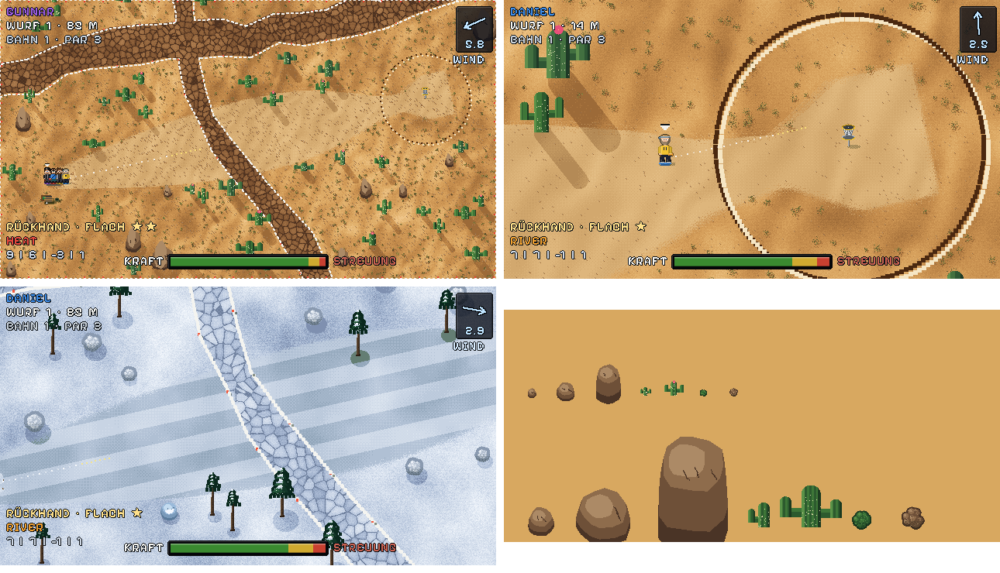

# Wochenkurs: Ablauf jede Woche

Jede Woche gibt es einen neuen, zufällig erzeugten Kurs mit eigenem Thema und eigener Bestenliste.
Zurzeit 6 Bahnen pro Woche (`ANZAHL_STANDARD` in `werkzeuge/wochenbahn.mjs`), Ziel später: 18.

## Zeitplan (deutsche Zeit)

| Wann | Was | Wer |
|---|---|---|
| **Donnerstag 18:00** | Abfrage des Themas für die nächste Woche | geplante Aufgabe in Claude Code (neue Session, Push-Nachricht) |
| nach der Antwort | Kurs bauen und auf `dev` pushen → testen unter www.discgolf-game.de/dev/ | Claude in dieser Session |
| bis Sonntag ~20:00 | Befunde gemeinsam fixen (auf `dev`) | du + Claude |
| **Sonntag 11:47** | Prüfung: Gibt es den Kurs für die kommende Woche? Wenn nicht: eigenes Thema ausdenken, Kurs bauen, auf `dev` pushen | geplante Aufgabe in Claude Code |
| **Sonntag ab 20:00** | nur `wochenbahnen.js` wird von `dev` nach `main` kopiert (fehlt der Kurs noch immer: zufällig mit vorhandenem Thema) | Action „Wochenbahn live“ |
| **Montag 0:00** | das Spiel zeigt den neuen Kurs (schaltet selbst nach Datum um), der alte wandert ins Archiv | Spiel |

Die Wochen-Bestenliste: pro Person zählt die beste ganze Runde der Woche (Kurs-ID `woche-<jahr>-<kw>`).
Live gibt es nur die ganze Runde. In der Vorschau `/dev/` sind auch einzelne Bahnen wählbar, und die
Bestenliste heißt `vorschau-woche-…`, Testrunden zählen also nicht.
Archiv mit Siegern und alten Kursen (spielbar ohne Wertung): www.discgolf-game.de/archiv/

## Kurs bauen

```
node werkzeuge/wochenbahn.mjs --thema wueste                      # Kurs für die kommende Woche
node werkzeuge/wochenbahn.mjs --thema wueste --seed 3             # neu würfeln (gleiche Woche wird ersetzt)
node werkzeuge/wochenbahn.mjs --thema wueste --name "Fata Morgana" # Kursname vorgeben (KWxx kommt automatisch dazu)
node werkzeuge/wochenbahn.mjs --thema wueste --bahnen 18          # andere Anzahl Bahnen
node werkzeuge/wochenbahn.mjs --pruefen                           # wochenbahnen.js prüfen
node werkzeuge/grafik_vorschau.mjs                                # (Bilder einer Bahn aus bahnen.js)
```

- Bahntypen der Wüste (zufällig, gewichtet): **quer** (Flussbett quer über die Bahn), **insel** (Korb auf einer Insel
  im Flussbett), **schlucht** (enger Gang zwischen zwei Felswänden), **mando** (Lücke in einem Felsriegel, Mando-Linie),
  **offen** (Kakteenfeld). Dazu Doglegs links/rechts, zufälliges senkrechtes Spiegeln und wechselnde Dichte. Gespielt wird immer von links
  nach rechts (hochkant: von unten nach oben), nie waagerecht gespiegelt.
- Felsen haben `fest: true`: Die Scheibe prallt immer ab (nie bremsen/durchfliegen), rutscht nicht hinein und bleibt
  nie auf einem Fels liegen. Felswände sind Mauern mit `art: "felswand"`, `h: 30` (nicht zu überfliegen), `breite`
  und `seite` (Felsband liegt außen); in der Schlucht mit `bisRand: true`: die Wandlinie läuft von Rand zu Rand,
  die Fläche dahinter ist Fels bis zum Spielfeldrand (kein Weg außen herum). Kein Text bei Treffern an Felsen, Kakteen und Felswänden.
- Thema **Herbstnacht** (`--thema herbstnacht`): dunkler Herbstwald am Abend, Weiher und Bäche als OB (`art: "wasser"`),
  Bahntypen **mando** (Lücke in einem Baumriegel), **insel** (Korb auf einer Insel im Weiher), **inselkette** (Par 4:
  ab `ab` alles Wasser, mehrere Inseln hintereinander – `insel` = Korbinsel, `inseln` = weitere; das gewellte Ufer ist ein Ring in `inseln` von Rand zu Rand, die gerade Linie bei `ab` wird nur gezeichnet, wo Wasser angrenzt), **quer** (Bach quer),
  **offen** (Wald); nie zwei kreuzende Bäche. Reihenfolge der Typen über `plan` im Thema (`--typen a,b,…` überschreibt), `typPar` legt das Par
  eines Typs fest (inselkette: 4). Optik: `optikDaten` mit `nacht: true` (Mond, Sterne, dunkle Wolken in der
  Putt-Ansicht), `glow: true` (alle Scheiben leuchten grün wie Phosphor-Glow), `wasser`, `laubbaumVarianten`,
  `wolken` – das ist Spiel-Code ab dem Release nach 0.9.0; ohne ihn bleibt die Bahn spielbar, aber ohne Glow/Mond,
  Wasser als dunkles Aus und mit nur einer Insel (Inselkette dann nicht spielbar).
- Par per Zufall: ~88 % Par 3 (60–140 m), ~10 % Par 4 (140–200 m), ~2 % Par 5 (201–250 m), `--par` erzwingt.
- Namen: Kurs = Fantasiename + „ KWxx“, jede Bahn einen eigenen Fantasienamen (keiner doppelt; das Thema
  braucht mindestens Anzahl + 1 Namen).
- Der Kurs steht danach als feste Daten in `wochenbahnen.js`; Fixes (Kaktus versetzen, OB ändern …) gehen
  direkt dort von Hand.
- `physik.js`, `bahnen.js` und die Referenzwürfe bleiben unberührt.

## Neues Thema

1. In `werkzeuge/wochenbahn.mjs` unter `THEMEN` einen Eintrag anlegen: `name` (Anzeige), `optik`
   (Schlüssel in `JAHRESZEITEN`), `namen` (mindestens Bahnen + 1 Fantasienamen, für 18 Bahnen also 19+) und `baue(z, g, L)`, das
   Hindernisse (`baeume` mit `r`, `h` und `art`), `ob` und `wege` liefert. Vorlage: `wueste`.
2. Die Optik festlegen – zwei Wege:
   - **ohne Release (bevorzugt für schnelle Themen):** `optikDaten` im Thema angeben: Paletten wie in
     `JAHRESZEITEN.wueste` (gras, aus, fair, weg, flussbett, fels, busch, himmel, laubbaum als Farbliste …),
     `basis` = vorhandene Optik für den Rest, `circle` = [dunkel, hell] für Circle 1 auf hellem Boden, `wueste: true` für Sand-Boden/Kakteen-Szene. Die Daten
     landen mit in `wochenbahnen.js` und gehen so am Sonntag live. Nutzbar sind die vorhandenen Arten:
     Hindernisse `kaktus`, `fels`, `busch` oder normale Bäume (ohne `art`), OB `flussbett`, Zaun, Linie –
     und **eigene Gegenstände** über `objekte` (siehe unten).
   - **mit Release:** fester Eintrag in `JAHRESZEITEN` (`grafik.js`), eine neue **Form** für Gegenstände
     (Zeichner in `ZEICHNER`/`OBJEKT_FORMEN`), neue Bodenarten wie `flussbett`, eigene Putt-Szene
     wie `wuestenSzene`.
3. Bilder in der 3/4-Ansicht prüfen (alle Gegenstände stehen aufrecht, Figuren verschwinden dahinter).
4. Ist das Thema eine Jahreszeit (z. B. Winter), reicht `optik: "winter"`, sonst gibt es keine Jahreszeiten
   auf Wochenbahnen.
5. Bilder prüfen (alle Bahnen, Putt-Ansicht), dann bauen, `--pruefen`, committen, auf `dev` pushen.

## Gegenstände in der 3/4-Ansicht

Alles, was auf einer Bahn steht, ist ein Eintrag in `baeume`: `x`, `y`, `r` (Radius in m, zugleich die
Trefferfläche), `h` (Höhe in m) und `art`. Das Spiel zeichnet jeden Gegenstand als aufrechtes Sprite;
die Höhe wird mit 0,6 auf den Bildschirm projiziert – genau wie die Flughöhe der Scheibe. Was eine Art ist,
steht im Baukasten in `grafik.js`:

- **Formen** (`OBJEKT_FORMEN`, Code): `krone` (Stamm + Laubkrone), `kegel` (Stamm + Nadelbaum-Kegel),
  `saeule` (Säule mit Armen, z. B. Kaktus), `brocken` (Fels mit Seite und Oberseite), `kugel` (rund auf dem
  Boden, z. B. Busch).
- **Eingebaute Arten** (`OBJEKT_ARTEN`): `kaktus` → saeule, `fels` → brocken, `busch` → kugel.
  Ohne `art` ist es ein Baum (Laub/Kiefer nach Lage, im Winter kahl).
- **Eigene Arten eines Themas – ohne Release:** in `optikDaten` eintragen, z. B.
  ```js
  optikDaten: { basis: "winter", objekte: {
    eisblock: { form: "brocken", farben: ["#5a7a9a", "#7a9aba", "#9abada", "#c4dcf0", "#eef6ff"] },
    tanne:    { form: "kegel",   farben: "kiefer" },   // Palettenname der Optik statt Farbliste
  } }
  ```
  `farben`: mind. 5 Farben von dunkel nach hell oder der Name einer Palette der Optik (`fels`, `busch`,
  `laubbaum`, `kiefer` …). Unbekannte Arten erscheinen als graue Kugel, damit nie etwas unsichtbar ist.
- Physik: Gegenstände bremsen bzw. werfen die Scheibe wie Bäume; mit `fest: true` prallt sie immer ab (Felsen).
- `--pruefen` meldet Gegenstände mit unbekannter Art oder Form und solche ohne Höhe `h`.

(Wüste in Übersicht und nah; Beispiel-Thema nur aus Daten: Tannen, Schneemänner, Eisblock; Formen einzeln)

- **Eine neue Form** (etwas, das sich mit den fünf nicht darstellen lässt) braucht Code in `ZEICHNER` und
  ein Release **vor** dem Sonntag, an dem die Bahn live geht.

## Releases

- Der Wochenkurs braucht kein Release: Die Action kopiert nur `wochenbahnen.js` nach `main`.
- Der Generator (`werkzeuge/`) läuft nur auf `dev` und braucht kein Release.
- Änderungen an Spiel-Code und Grafik (`grafik.js`, `index.html`, `wochen.js`) kommen erst mit einem normalen
  Release nach `main`. **Wichtig:** Braucht ein Thema neue Zeichenarten, muss das Release vor Sonntag 20:00
  live sein, sonst fehlt `main` die Optik (die Bahn erscheint dann in der Jahreszeit-Optik). Sonst `optikDaten` nehmen.
- Die 3/4-Ansicht selbst ist Spiel-Code: Sie ist erst nach dem Release (ab 0.9.0) auf `main` live. Danach sind
  alle Wochenbahnen automatisch in 3/4, auch neue Themen mit eigenen Arten aus `optikDaten.objekte`.
